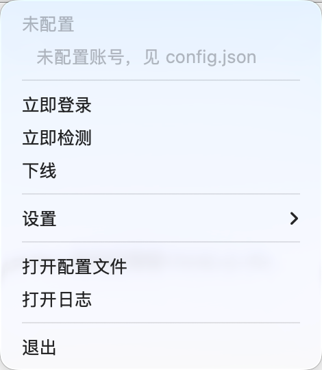
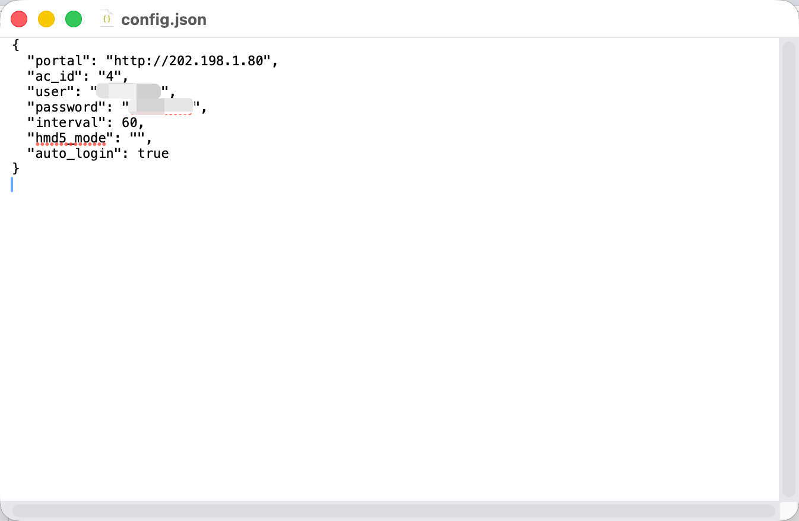

# 吉林农业大学校园网自动登录

> [!IMPORTANT]
> **免责声明**  
> 本项目仅供学习交流使用，请勿用于商业用途。使用本工具产生的一切后果由使用者自行承担。  
> 请遵守学校相关网络使用规定，合理使用校园网络资源。

<p align="center">
  <strong>开箱即用的校园网自动登录工具</strong><br>
  零依赖 Python 客户端 + 原生托盘应用
</p>

<p align="center">
  <a href="https://github.com/wsbjj/jlau-srun/releases"></a>
  <a href="https://github.com/wsbjj/jlau-srun/actions"></a>
  <a href="LICENSE"></a>
</p>

---

## ✨ 特性

- 🚀 **开箱即用** - 配置账号密码即可使用
- 💻 **跨平台支持** - macOS / Linux / Windows
- 🎯 **自动重连** - 断网自动检测并重新登录
- 📦 **零依赖** - Python 客户端无需安装额外依赖
- 🖥️ **原生托盘** - Rust 编写的系统托盘应用
- 📱 **在线设备** - 自助服务「在线信息」免验证码登录，列出每台设备的上线时间 / MAC / IP
- ⚡ **开机自启** - 支持系统服务自动启动

---

## 📦 下载

从 [Releases](https://github.com/wsbjj/jlau-srun/releases/latest) 页面下载适合你系统的版本：

| 平台 | 文件 | 说明 |
|------|------|------|
| **macOS** (Apple Silicon) | `JLAU校园网-1.0.5.dmg` | 双击安装，拖入 Applications |
| **Windows** (x64) | `JLAU校园网-1.0.5-windows-x64.exe` | 直接运行 |
| **Linux** (x64) | `JLAU校园网-1.0.5-linux-x64.tar.gz` | 解压后运行 |

> 💡 所有版本都包含托盘应用。如果只需要 Python 脚本，可以直接下载本仓库的 `srun_login.py` 文件。

---

## 🚀 快速开始

### 方法一：使用托盘应用（推荐）

#### macOS

1. 下载并打开 `JLAU校园网-1.0.5.dmg`
2. 将应用拖入 `Applications` 文件夹
3. 首次打开需要在「系统设置 → 隐私与安全性」中允许
4. 点击菜单栏图标，按照下方「配置账号」说明填写

#### Windows

1. 下载 `JLAU校园网-1.0.5-windows-x64.exe`
2. 双击运行（Windows Defender 可能提示，选择「仍要运行」）
3. 右键系统托盘图标，按照下方「配置账号」说明填写

#### Linux

```bash
# 解压
tar -xzf JLAU校园网-1.0.5-linux-x64.tar.gz
cd JLAU校园网-linux-x64

# 配置账号（按照下方「配置账号」说明）
nano config.json

# 运行
./jlau-srun-menubar
```

### 托盘应用界面

<p align="center">
  
</p>

**功能说明：**
- 📝 **未配置** - 首次使用时提示配置账号，点击「设置」或「打开配置文件」进行配置
- 🔑 **立即登录** - 手动触发登录（配置完成后可用）
- 🔍 **立即检测** - 检测当前网络连接状态
- 📡 **下线** - 退出登录，断开校园网
- 🖥️ **在线设备（N 台）** - 自助服务「在线信息」里的全部在线会话，每行显示 `IP · 上线时间 · MAC`；子菜单里的「刷新设备」立即重查
- 🌐 **自助服务平台** - 在浏览器打开门户自助服务（`:8800`），自动带上 SSO 参数，免一次验证码登录
- ⚙️ **设置** - 打开设置窗口配置账号密码（推荐）
- 📄 **打开配置文件** - 直接用文本编辑器打开 `config.json`
- 📋 **打开日志** - 查看详细运行日志

---

## ⚙️ 配置账号（重要）

### 配置文件位置

应用会自动在以下位置查找或创建 `config.json`：

- **macOS**: `~/.config/jlau-srun/config.json` 或应用同目录
- **Linux**: `~/.config/jlau-srun/config.json` 或应用同目录
- **Windows**: `%APPDATA%\jlau-srun\config.json` 或应用同目录

### 配置文件示例

<p align="center">
  
</p>

### 详细配置说明

打开 `config.json` 文件，你会看到以下内容：

```json
{
  "portal": "http://202.198.1.80",
  "ac_id": "4",
  "user": "",
  "password": "",
  "interval": 60,
  "hmd5_mode": "",
  "selfservice": "",
  "auto_login": true
}
```

### 📝 必填项（必须修改）

#### 1. `user` - 校园网账号

**填写内容：** 你的学号或工号

```json
"user": "2021001234"
```

- ✅ **正确示例**: `"2021001234"`（你的学号）
- ❌ **错误示例**: `""`（空字符串）、`"user"`（示例文字）

> 💡 **提示**: 就是你平时登录校园网时输入的账号

#### 2. `password` - 校园网密码

**填写内容：** 你的校园网登录密码

```json
"password": "your_password_here"
```

- ✅ **正确示例**: `"MyP@ssw0rd123"`（你的实际密码）
- ❌ **错误示例**: `""`（空字符串）、`"password"`（示例文字）

> 💡 **提示**: 密码会保存在本地配置文件中，请注意文件权限安全

### 🔧 可选项（通常不需要修改）

#### 3. `portal` - 认证服务器地址

**默认值**: `"http://202.198.1.80"`

**说明**: 吉林农业大学校园网认证服务器地址，**一般不需要修改**

#### 4. `ac_id` - 接入点 ID

**默认值**: `"4"`

**说明**: 本校 WiFi 的接入点标识，**固定为 "4"，不要修改**

#### 5. `interval` - 检测间隔

**默认值**: `60`（单位：秒）

**说明**: 每隔多少秒检测一次网络状态，断网时自动重连

- 推荐范围: `30` ~ `300` 秒
- 设置过小会频繁检测，消耗资源
- 设置过大会导致断网后长时间无法自动重连

```json
"interval": 60    // 每 60 秒检测一次
```

#### 6. `hmd5_mode` - 加密模式

**默认值**: `""`（空字符串）

**说明**: 加密模式参数，**保持为空字符串即可**

#### 7. `auto_login` - 自动登录

**默认值**: `true`

**说明**: 启动后是否自动登录

- `true`: 启动后自动登录（推荐）
- `false`: 启动后需要手动点击「立即登录」

```json
"auto_login": true    // 自动登录
```

#### 8. `selfservice` - 自助服务平台地址

**默认值**: `""`（留空自动推导为 `portal` 同主机 `:8800`）

**说明**: 「在线设备」「自助服务平台」菜单访问的地址。只有学校换了端口才需要改。

```json
"selfservice": "http://202.198.1.80:8800"
```

### ✅ 完整配置示例

假设你的学号是 `2021001234`，密码是 `MyPassword123`，完整配置应该是：

```json
{
  "portal": "http://202.198.1.80",
  "ac_id": "4",
  "user": "2021001234",
  "password": "MyPassword123",
  "interval": 60,
  "hmd5_mode": "",
  "auto_login": true
}
```

### 🎯 快速配置三步走

1. **找到配置文件**: 点击托盘图标 → 「打开配置文件」
2. **填写账号密码**: 修改 `user` 和 `password` 两项
3. **保存并重启**: 保存文件，重启应用（或点击「立即登录」）

---

## 🚀 方法二：使用 Python 脚本

如果你不需要托盘应用，只想用命令行脚本：

### 1. 下载脚本

```bash
# 克隆仓库
git clone https://github.com/wsbjj/jlau-srun.git
cd jlau-srun

# 或直接下载脚本文件
curl -O https://raw.githubusercontent.com/wsbjj/jlau-srun/main/srun_login.py
```

### 2. 创建配置文件

```bash
# 复制配置模板
cp config.example.json config.json

# 编辑配置（填写你的账号密码）
nano config.json   # 或用你喜欢的编辑器
```

按照上方「配置账号」说明填写 `user` 和 `password`。

### 3. 运行

```bash
# 直接运行（前台）
python3 srun_login.py

# 后台运行
nohup python3 srun_login.py > srun.log 2>&1 &
```

### 4. 设置开机自启（可选）

**macOS:**

```bash
cd deploy
bash install_macos.sh
```

**Linux (systemd):**

```bash
# 编辑 deploy/jlau-srun.service，修改路径
sudo cp deploy/jlau-srun.service /etc/systemd/system/
sudo systemctl enable jlau-srun
sudo systemctl start jlau-srun

# 查看状态
sudo systemctl status jlau-srun
```

---

## 🐛 常见问题

### 1. 托盘显示「未配置账号，见 config.json」

**原因**: 配置文件中 `user` 或 `password` 为空

**解决方法**: 
1. 点击托盘图标 → 「打开配置文件」
2. 填写你的学号和密码
3. 保存文件后点击「立即登录」或重启应用

### 2. macOS 提示「无法打开，因为无法验证开发者」

**解决方法**:
- 打开「系统设置 → 隐私与安全性」
- 找到被拦截的应用，点击「仍要打开」

### 3. Windows Defender 提示病毒

**原因**: 未签名的应用会被误报

**解决方法**:
- 点击「更多信息 → 仍要运行」
- 或将应用添加到 Windows Defender 白名单

### 4. Linux 提示权限不足

```bash
chmod +x jlau-srun-menubar
```

### 5. 登录失败 / 密码错误

**检查清单**:
- ✅ `config.json` 中账号密码是否正确（注意空格、大小写）
- ✅ 账号是否已在网页端正常登录过
- ✅ 账号是否欠费或被停用
- ✅ 是否连接到校园网 WiFi

**调试方法**:
1. 先用浏览器访问 `http://202.198.1.80` 手动登录测试
2. 查看日志文件（点击「打开日志」）
3. 确认错误提示信息

### 6. 如何查看日志？

**托盘应用**: 点击托盘图标 → 「打开日志」

**Python 脚本**: 
```bash
# 前台运行时直接显示
python3 srun_login.py

# 后台运行时查看日志文件
tail -f srun.log
```

### 7. 如何卸载？

**macOS**:
```bash
# 删除应用
rm -rf /Applications/JLAU校园网.app

# 删除配置和日志
rm -rf ~/.config/jlau-srun
```

**Windows**:
- 直接删除 `.exe` 文件
- 删除 `%APPDATA%\jlau-srun` 目录

**Linux**:
```bash
# 删除应用和配置
rm -rf ~/jlau-srun-menubar ~/.config/jlau-srun
```

---

## 📚 技术文档

想了解实现细节？查看 [技术文档](docs/TECHNICAL.md)：

- 认证流程与接口分析
- 加密算法实现
- 协议逆向过程
- 源码结构说明

---

## 🤝 贡献

欢迎提交 Issue 和 Pull Request！

### 开发环境

```bash
# Python 客户端
python3 srun_login.py

# Rust 托盘应用
cd menubar
cargo build --release
```

---

## 📄 许可

[MIT License](LICENSE)

---

## ⭐ Star History

如果这个项目对你有帮助，欢迎 Star ⭐

---

<p align="center">
  Made with ❤️ for JLAU Students
</p>


